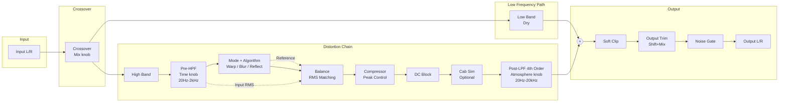

# Tempest

A saturation/distortion engine for the Qu-Bit Aurora module with 36 algorithms across 6 banks and 3 modes. Inspired by the Ohmforce Ohmicide

## Signal Path



### Signal Flow Details

1. **Input**: Stereo audio input
2. **Crossover** (Mix knob, 20-500Hz): Splits signal into low and high frequency bands
   - Low frequencies pass through dry (preserves bass punch)
   - High frequencies go through distortion chain
3. **Pre-Filter** (Time knob, 20Hz-2kHz): High-pass filter before distortion
4. **Mode + Algorithm**: Distortion processing with selected algorithm and FAM mode
5. **Balance**: RMS-based level matching - matches distorted output to input loudness
6. **Compressor**: Gentle peak control (threshold -3dB, ratio 8:1, attack 5ms, release 50ms)
7. **DC Block**: Removes DC offset from asymmetric distortion before cab sim
8. **Cab Sim** (optional, toggle with 5s hold on Freeze): V30 4x12 cabinet emulation
   - Resonant thump at 80Hz
   - Phase smear (0.4ms delay)
9. **Post-Filter** (Atmosphere knob, 20Hz-20kHz): 4th-order low-pass for tone shaping
10. **Combine**: Dry low frequencies + processed high frequencies
11. **Soft Clip**: Safety limiter to prevent digital clipping
12. **Output Trim** (Shift+Mix, 0-2x): Final volume control after all processing
13. **Noise Gate**: Removes noise floor (threshold scales with drive)
14. **Output**: Stereo audio output

## Controls

| Knob | CV Input | Function | Range |
|------|----------|----------|-------|
| **Warp** | CV_WARP | Drive/gain | 1x to 100x (0 to +40dB, logarithmic) |
| **Blur** | CV_BLUR | Blur parameter | Algorithm-specific modulation |
| **Reflect** | CV_REFLECT | BIAS parameter | Bipolar with dead center (+/-1%), scaled 15% for S mode only |
| **Atmosphere** | CV_ATMOSPHERE | Post-filter cutoff | 20Hz to 20kHz (low-pass) |
| **Time** | CV_TIME | Pre-filter cutoff | 20Hz to 2kHz (high-pass) |
| **Mix** | CV_MIX | Crossover frequency | 20Hz to 500Hz |
| **Shift+Mix** | — | Output trim | 0x to 2x (default 60%) |

### CV Inputs

All CV inputs are bipolar (-5V to +5V, normalized to -1 to +1) and add directly to the corresponding knob value. The combined value is clamped before applying any scaling or mapping.

- **CV_WARP**: Modulates drive amount. Use with envelope for dynamic distortion.
- **CV_BLUR**: Modulates algorithm variation. Use with LFO for animated textures.
- **CV_ATMOSPHERE**: Modulates post-filter cutoff. Use for filter sweeps.
- **CV_TIME**: Modulates pre-filter cutoff. Use for dynamic bass control.
- **CV_REFLECT**: Adds to BIAS after dead-center detection. Use for asymmetry modulation.
- **CV_MIX**: Modulates crossover frequency (normal mode only, not during Shift+Mix).

### Reflect Knob Behavior

- **Dead center zone**: +/- 1% around center snaps to zero bias
- **Visual feedback**: Current algorithm LED flashes white for 1 second when entering dead center
- **Range scaling**: S mode uses 15% of full range for finer control; X and O modes use full range

## Buttons

| Button | Function |
|--------|----------|
| **Reverse** | Next algorithm in bank |
| **Freeze** | Previous algorithm in bank |
| **Shift + Reverse** | Next bank |
| **Shift + Freeze** | Cycle Mode (S → X → O) |
| **Hold Freeze 5s** | Toggle V30 Cab Sim (LEDs blink 3x to confirm) |

## Gate Inputs

| Gate | Function |
|------|----------|
| **GATE_FREEZE** | Algorithm Hold - freezes input sample through distortion for buzzing sustain |
| **GATE_REVERSE** | Octave Up - full-wave rectification doubles fundamental frequency |

## LED Display

| LED | Function |
|-----|----------|
| **LED_REVERSE** | Bank color (80% intensity) |
| **LED_FREEZE** | Mode color (80% intensity) |
| **LED_1 to LED_6** | Current algorithm (bank color) + distortion meter (inactive LEDs) |
| **LED_BOT_1/2/3** | Mode color with distortion-reactive intensity |

### Distortion Meter

The 5 inactive algorithm LEDs display a real-time VU-style distortion meter with a color gradient:

| Level | Color |
|-------|-------|
| Low (0-33%) | Green |
| Medium (33-66%) | Orange → Red |
| High (66-100%) | Red → White |

The meter fills progressively with smooth intensity transitions.

### Bank Colors

| Bank | Color | Focus |
|------|-------|-------|
| Analog | Orange | Saturation & soft clipping |
| Fold | Purple | Wavefolding & complex shaping |
| Geometric | Yellow | Variable geometric shaping |
| LoFi | Cyan | Digital degradation |
| Chaos | Red | Noise & physics |
| Temporal | Green | Time-based & experimental |

### Mode Colors (LED_FREEZE)

| Mode | Color | Description |
|------|-------|-------------|
| S (Standard) | Green | Raw algorithm with DC offset bias |
| X (Xxx) | Orange | Tube amp simulation |
| O (Odd) | Purple | Inharmonic distortion |

## Modes

### S - Standard

Raw distortion algorithm. The BIAS parameter adds a DC offset before the distortion is applied (scaled to 15% for usable range). The DC offset is removed after processing.

### X - Xxx (Tube)

Simulates a tube amplifier with:

| Bias Position | Tube Type | Sonic Character |
|---------------|-----------|-----------------|
| **-1.0** | Starved Plate | Gritty, buzzy, dying amp with crossover distortion dead zone |
| **-0.5** | Rectifier Sag | Spongy, compressed attack, blooming sustain |
| **0.0** | Triode | Warm, smooth, classic tube with asymmetric clipping |
| **+0.5** | Pentode | Tight, punchy, harder knee, more odd harmonics |
| **+1.0** | Power Tube Overdrive | Aggressive, saturated, full stack with grid blocking |

**Key features:**
- **Rectifier sag simulation** (negative bias): Envelope follower reduces gain on transients, creating that "spongy" vintage amp feel
- **Crossover distortion** (far negative bias): Dead zone near zero crossing for broken/starved amp sound
- **Triode vs Pentode waveshaping**: Smooth morphing between soft asymmetric (triode) and harder symmetric (pentode) curves
- **Grid blocking** (positive bias): Asymmetric compression on positive peaks for power tube character
- **Harmonic blend**: Even harmonics (2nd) emphasized on negative bias, odd harmonics (3rd) on positive bias

### O - Odd (Inharmonic)

Creates inharmonic distortion through envelope-based amplitude modulation:
- Positive BIAS: Expands harmonic spacing
- Negative BIAS: Compresses harmonic spacing
- Center: Minimal effect

Uses full BIAS range for maximum effect.

## V30 Cabinet Simulation

Toggle by holding the Freeze button for 5 seconds (without Shift). LEDs blink white 3 times to confirm toggle. State is saved to flash.

Emulates a V30-loaded 4x12 cabinet without impulse responses:

| Component | Description |
|-----------|-------------|
| **Resonant Thump** | Peaking filter at 80Hz, Q=2.5, +6dB (cabinet air resonance) |
| **Phase Smear** | 0.4ms delay mixed at -6dB (speaker interference pattern) |

The Post-LPF (Atmosphere knob) provides the high-frequency rolloff, allowing user control of the "fizz" removal.

## Parameter Recall

Settings are automatically saved to flash memory and restored on power-up:
- Current bank
- Current algorithm
- Current mode
- Output trim level

Settings are saved 2 seconds after the last change to reduce flash wear.

## Algorithms (6 Banks × 6 Algorithms = 36 Total)

For detailed sonic characteristics, use cases, and parameter effects, see [algorithms.md](algorithms.md).

### Bank 1: Analog Saturation & Soft Clipping (Orange)

| Algorithm | Description |
|-----------|-------------|
| **SftClp** | Soft log-shaped waveshaper, Blur adds asymmetry |
| **HardClp** | Hard inverse-shaped curve, Blur adds asymmetry |
| **StrgrC** | Strong tangent-inverse curve, Blur adds asymmetry |
| **Valve** | Asymmetric soft tanh, Blur reduces even harmonics |
| **Antipol** | Hard clipper, high Warp+Blur causes signal folding |
| **Disto** | Limiter with analog feel, Blur controls attack/release |

### Bank 2: Wavefolding & Complex Shaping (Purple)

| Algorithm | Description |
|-----------|-------------|
| **WavFld** | Sine-based wavefolder |
| **Crest** | Non-bijective with folding near clipping |
| **Sstrgi** | Waveshaper with ripples (multiple folds) |
| **Fezz** | Asymmetric waveshaper, Blur increases asymmetry |
| **Fuss** | Asymmetric with positive folding |
| **Cross** | Soft non-bijective affecting low signal portions |

### Bank 3: Geometric & Variable Shaping (Yellow)

| Algorithm | Description |
|-----------|-------------|
| **VariWS** | Variable asymmetric waveshaper, Blur controls shape |
| **SmartE** | Varying waveshape controlled by Blur |
| **Vshpe** | Anti-symmetric V-shape, produces higher pitches |
| **Square** | U-shaped rectifier, dries signal significantly |
| **Cubic** | Symmetric waveshaper crushing low signal |
| **Anti+** | Antipol with additional crest waveshaper |

### Bank 4: Digital Degradation / Lo-Fi (Cyan)

| Algorithm | Description |
|-----------|-------------|
| **Bitcrsh** | Bit depth reduction, Blur reduces resolution |
| **DwnSpl** | Analog sample & hold, Blur changes sample rate |
| **Lowfi** | Slew rate limiter, Blur controls slew rate |
| **Lowrfi** | Non-linear slew rate distortion |
| **ChastB** | Floating-point mantissa distortion |
| **SuspB** | Floating-point exponent distortion |

### Bank 5: Chaos, Noise & Physics (Red)

| Algorithm | Description |
|-----------|-------------|
| **Fractl** | Chaotic feedback equation, Blur controls depth |
| **Zippy** | Lorenz attractor chaos, Blur varies frequency |
| **Bounce** | Ball in cylinder physics, Blur controls inertia |
| **NoizE** | Cyclic triangular folder, high gain = white noise |
| **BrwnNz** | Brownian noise / random walk waveshaper |
| **Attrac** | Chaotic attractor steering to +/-5V |

### Bank 6: Temporal, Filtered & Experimental (Green)

| Algorithm | Description |
|-----------|-------------|
| **Filter** | Waveshaper + resonant LPF, Warp controls resonance |
| **TimeFr** | Delay line freezing based on envelope |
| **Vinyl** | RIAA EQ curves + stylus degradation |
| **Clicks** | Vinyl-style clicks, Blur controls density |
| **Jelly** | Envelope follower driven distortion |
| **Accum** | Experimental low-frequency accumulator |

## Building

```bash
cd Firmware/Tempest
make
```

The firmware binary will be at `build/Tempest.bin`.

## Flashing

1. Copy `Tempest.bin` to a USB drive
2. Insert USB drive into Aurora
3. Follow Aurora firmware update procedure
